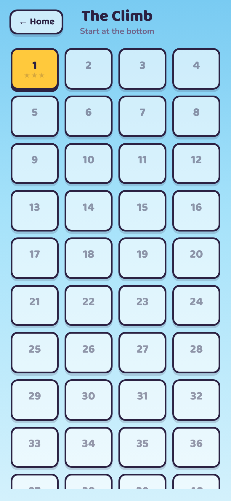

# Endless Quiz

A quiz game in the same visual style as Color Match & Merge: bright sky,
thick ink outlines, hard drop shadows.

**Status: early build.** 100 Climb levels, the Daily Quiz, Quick Play with
categories and seeds, settings and the guide all work. The bank holds 496
written and fact-table questions plus endless generated maths.

Open `index.html` in a browser. No build step or server is needed.

Played online at https://polite-carrot.github.io/Endless-Puzzle/ via GitHub Pages.

**Every release, bump the build number in three places together:** the `?v=`
on the links in `index.html`, `BUILD` in `js/app.js`, and `version.json`
(currently 10).
GitHub Pages lets browsers keep files for ten minutes — the page itself
included — so a phone can keep running an old build. The `?v=` stops a new
page loading an old stylesheet; `version.json` (fetched uncached on start
and whenever the game comes back on screen) lets an old page notice a newer
build exists and reload itself onto it, between questions.

<p>
  
  
  
  
</p>
<p>
  
  
  
  
</p>
<p>
  
  
</p>

## Quick Play

Laid out like the jar game's Random Puzzle: a **difficulty slider** (Mixed,
Easy, Normal, Hard, Extra Hard), **category chips** to pick what you're
quizzed on, a **− / +** count from 5 to 30, and a **seed**.

Every deal comes from a seed — typed, or picked at random when the box is
blank. The same seed with the same settings deals the same questions with
the answers in the same places, so **Challenge a friend** on the results
card shares the seed and settings along with your score.

If the chosen difficulty and categories can't fill the quiz, the screen says
how many you'll get. With Maths ticked that never happens — maths is
generated, so it tops up any gap.

## Daily Quiz

Five questions a day — easy, easy, normal, hard, extra hard — the same for
everyone. **The date is the seed** (12 Oct 2026 deals from `20261012`), so
nothing is downloaded: two people opening the same day get the same
questions with the answers in the same places. A new quiz arrives at the
player's own midnight.

- **One go.** Each answer is saved the moment it is given, so leaving
  part-way and coming back carries on rather than re-rolls. The day's
  question ids are saved when it's started, so growing the bank mid-day
  can't swap a half-played quiz for another.
- **No 50/50**, so every score is comparable.
- **Streak** counts back from today. Today not being played yet doesn't
  break it until midnight passes.
- **Share** copies a spoiler-free grid: `🟩🟩🟥🟩🟩 4/5`.

## The Climb

**100 levels**, each a ladder of **20 rungs**, built ahead of time into
`js/levels.js` by `tools/build-levels.js`. Finish a level to unlock the next.

| Level | Easy | Normal | Hard | Extra Hard |
|------:|-----:|-------:|-----:|-----------:|
| 1     | 14   | 5      | 1    | 0          |
| 25    | 6    | 9      | 4    | 1          |
| 50    | 2    | 7      | 8    | 3          |
| 75    | 0    | 4      | 10   | 6          |
| 100   | 0    | 1      | 9    | 10         |

Levels in between blend smoothly from those anchors. Inside a level the
rungs run easiest first, so level 1 is fourteen easy questions, five normal
and one hard one at the very top.

**Safety nets** at rungs 4, 8, 12 and 16: a wrong answer drops you to the
last net you passed. **Every rung has a backup question**, so the way back
up after a fall asks something new: a rung's first showing asks its main
question, the second its backup, and after that a stand-in of the same
difficulty from the bank.

**Stars:** no falls ★★★, one or two ★★, more ★. Replaying keeps your best.
A climb in progress is saved — rung, falls and all.

### Building the levels

    node tools/build-levels.js

Levels are **baked**, not dealt on load. The bank will keep growing, and if
levels were dealt live, adding one question would reshuffle every level
after it — including ones people already have stars on. Rebuild only when
you mean to change the levels.

The builder deals written questions **least recently used first**, so a
repeat is as far from its last appearance as the bank allows, and spreads
categories within each level. About one slot in eight is generated maths.
It prints a report; the current one:

- 4,000 question slots (2,000 rungs × main + backup); 464 generated
- 385 distinct facts behind the 496 written/table questions (a capital asked
  both ways round is one fact), each used ~9 times across the 100 levels
- no level asks the same fact twice, even split across main and backup
- a fact comes back after at least 3 levels, typically 8

More written questions widen that gap — add to the bank, rebuild, and the
report shows the difference.

## Coins and the 50/50

- Correct answers pay coins: Easy 5, Normal 10, Hard 15, Extra Hard 25.
- The **50/50** removes two wrong answers and costs coins. Its price
  **doubles each time it is used in a game** (25, 50, 100…). It can be used
  once per question, and a question answered with it pays half.

## The question bank

Questions come from three places, all with the same shape:
`{ id, difficulty, category, q, answers: [correct, ...3 wrong], why }`.

| Source | Where | How many |
|--------|-------|---------:|
| Written by hand | `js/questions.js` | 142 |
| Fact tables — capitals, elements, planets, baby animals, animal groups, animal kinds, plurals, opposites, spellings, shapes, units and time | `js/bank.js` | 354 |
| Generators — 22 kinds of maths and Roman numerals | `js/bank.js` | endless |

**Fact tables** turn one checked row into one or two questions (Italy → Rome
asks both ways round). Wrong answers are written per row wherever a careless
pick could also be right: a group of geese is a gaggle but also a flock, so
"flock" is never offered. Reverse capital questions offer countries from the
same part of the world, so you can't rule them out by continent.

**One fact, one appearance.** "What is the capital of Italy?" and "Rome is the
capital of which country?" are two questions but one fact; every question
carries a `fact` key, and the level builder, the Daily and Quick Play never
put both halves in the same game. Generated maths that lands on a question
already written by hand rolls again, and every written question has its own
wording.

**Generators** work the answer out rather than having it written, so it
can't be wrong. A generated question is named by a reference like
`g:times12:48213` — the generator and a seed — and the same reference always
makes the same question. That is what lets a Climb level store a question
as a few characters.

    node tools/check-bank.js

checks every written and table question and 2,000 seeds of every generator:
four different answers, the right one never repeated among the wrong ones,
known category and difficulty, an explanation, no duplicates. Run it after
adding questions.

| Difficulty | Written + table | Generators |
|------------|----------------:|-----------:|
| Easy       | 79              | 4 kinds    |
| Normal     | 130             | 6 kinds    |
| Hard       | 166             | 6 kinds    |
| Extra Hard | 121             | 6 kinds    |

## Settings

Sound effects, vibration (only offered where the browser can vibrate —
iPhone and iPad browsers can't), and explanations after each answer. Also
shows your coins, Climb levels and daily streak, with a **Reset progress**
button behind a confirmation.

## Keeping progress

Coins, the climb in progress, stars per level, daily results, Quick Play
bests and settings live in the browser's own storage (`js/store.js`). Storage is
tested with a write-and-read-back before it is trusted; if the browser
refuses it (a private window, say) the game keeps playing from memory and
the home screen says plainly that progress won't be saved.

## Sound

Blips are made with oscillators, so nothing is downloaded. As in the jar
game, the audio device is suspended after a second and a half of quiet so
it can't hum, and is never opened while sound is off.

## Keyboard

`1`–`4` or `A`–`D` to answer · `H` for the 50/50 · `Enter` for the next question.

## Layout

```
index.html        every screen: home, climb levels, question, results, daily,
                  quick play, settings, how to play
styles.css        all styling (tokens shared with Color Match & Merge)
fonts.css         Baloo 2 + Nunito, inlined (copied from Color Match & Merge)
assets/           app icon: app-icon.png is the 1024px master; the others are
                  sized from it (home screen, manifest, favicon)
manifest.webmanifest  name and icons for installing to a home screen
version.json      the current build, checked on start to pick up updates
js/questions.js   categories, difficulties, the hand-written questions
js/bank.js        fact tables, generators, and the assembled bank  (no DOM)
js/levels.js      generated — the 100 Climb levels, as question references
js/store.js       saving progress, and whether it can be trusted
js/sound.js       oscillator blips
js/daily.js       the daily seed, streak and week   (no DOM)
js/app.js         screens and the shared question screen for all three modes
tools/check-bank.js    checks every question the bank can make
tools/build-levels.js  builds js/levels.js, and reports on reuse
```

Questions are stored as `{ id, difficulty, category, q, answers, why }`, with
the correct answer first in `answers`. The app shuffles them when it shows a
question. Stick to facts that don't go out of date.
