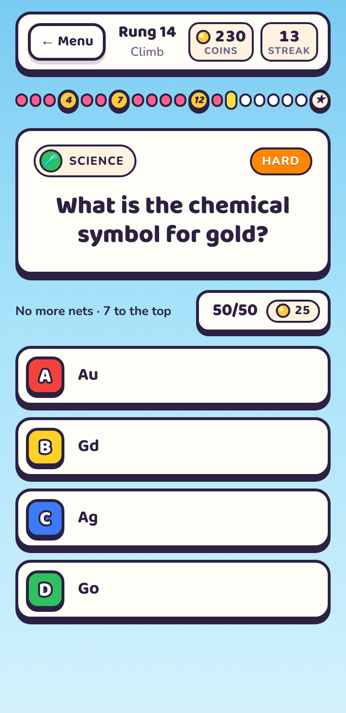

# Endless Quiz

A quiz game in the same visual style as Color Match & Merge: bright sky,
thick ink outlines, hard drop shadows.

**Status: early build.** All three modes, settings and the guide work, on a
bank of 80 questions — 20 per difficulty, so every difficulty can deal a
full 20-question Quick Play game.

Open `index.html` in a browser. No build step or server is needed.

Played online at https://polite-carrot.github.io/Endless-Puzzle/ via GitHub Pages.

**Every release, bump the build number in three places together:** the `?v=`
on the links in `index.html`, `BUILD` in `js/app.js`, and `version.json`.
GitHub Pages lets browsers keep files for ten minutes — the page itself
included — so a phone can keep running an old build. The `?v=` stops a new
page loading an old stylesheet; `version.json` (fetched uncached on start
and whenever the game comes back on screen) lets an old page notice a newer
build exists and reload itself onto it, between questions.

<p>
  
  
  
  
</p>
<p>
  
  
  
  
</p>

## Quick Play

Pick **how many questions** (5, 10 or 20) and **a difficulty**: Mixed, Easy,
Normal, Hard or Extra Hard. Mixed games run easiest first. No ladder, no
falling — just a score at the end, and your best for that setting is kept.
The 50/50 works here too.

Every difficulty has at least 20 questions, so a 20-question game never
repeats a question. If a difficulty ever has fewer than you ask for, you get
what there is and the screen says so.

## Daily Quiz

Five questions a day — easy, easy, normal, hard, extra hard — the same for
everyone. **The date is the seed** (12 Oct 2026 deals from `20261012`), so
nothing is downloaded: two people opening the same day get the same
questions with the answers in the same places. A new quiz arrives at the
player's own midnight.

- **One go.** Each answer is saved the moment it is given, so leaving
  part-way and coming back carries on rather than re-rolls.
- **No 50/50**, so every score is comparable.
- **Streak** counts back from today. Today not being played yet doesn't
  break it until midnight passes.
- **Share** copies a spoiler-free grid: `🟩🟩🟥🟩🟩 4/5`.

## The Climb

A run is a **20-rung ladder** that gets harder as you go:

| Rungs | Difficulty | Safety net |
|-------|------------|------------|
| 1–4   | Easy       | **4**      |
| 5–8   | Normal     | **8**      |
| 9–12  | Hard       | **12**     |
| 13–16 | Hard       | **16**     |
| 17–20 | Extra Hard | none (the star is the top) |

There is a safety net every four rungs. A wrong answer drops you back to the
last one you passed, or to the bottom if you haven't reached rung 4 yet. A
climb in progress is saved, so it survives closing the page.

**Planned:** 100 fixed Climb levels of 20 questions each, with a backup
question on every rung so a fall never replays a question you've just seen.

## Coins and the 50/50

- Correct answers pay coins: Easy 5, Normal 10, Hard 15, Extra Hard 25.
- The **50/50** removes two wrong answers and costs coins. Its price
  **doubles each time it is used in a game** (25, 50, 100…). It can be used
  once per question, and a question answered with it pays half.

## Settings

Sound effects, vibration (only offered where the browser can vibrate —
iPhone and iPad browsers can't), and explanations after each answer. Also
shows your coins, best climb and daily streak, with a **Reset progress**
button behind a confirmation.

## Keeping progress

Coins, the climb in progress, best climb, daily results, Quick Play bests and
settings live in the browser's own storage (`js/store.js`). Storage is
tested with a write-and-read-back before it is trusted; if the browser
refuses it (a private window, say) the game keeps playing from memory and
the home screen says plainly that progress won't be saved.

## Sound

Blips are made with oscillators, so nothing is downloaded. As in the jar
game, the audio device is suspended after a second and a half of quiet so
it can't hum, and is never opened while sound is off.

## Keyboard

`1`–`4` or `A`–`D` to answer · `H` for the 50/50 · `Enter` for the next question.

## Layout

```
index.html        every screen: home, question, results, daily, quick play,
                  settings, how to play
styles.css        all styling (tokens shared with Color Match & Merge)
fonts.css         Baloo 2 + Nunito, inlined (copied from Color Match & Merge)
js/questions.js   categories, difficulties, the question bank
js/store.js       saving progress, and whether it can be trusted
js/sound.js       oscillator blips
js/daily.js       the daily seed, streak and week   (no DOM)
js/app.js         screens and the shared question screen for all three modes
```

Questions are stored as `{ id, difficulty, category, q, answers, why }`, with
the correct answer first in `answers`. The app shuffles them when it shows a
question. Stick to facts that don't go out of date.
