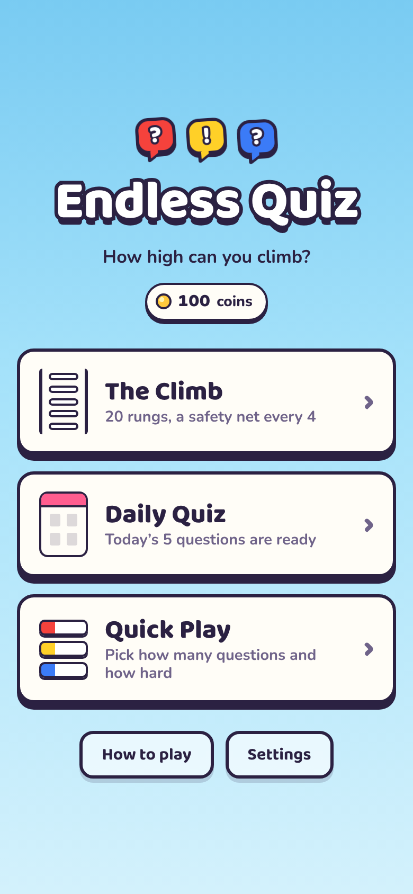
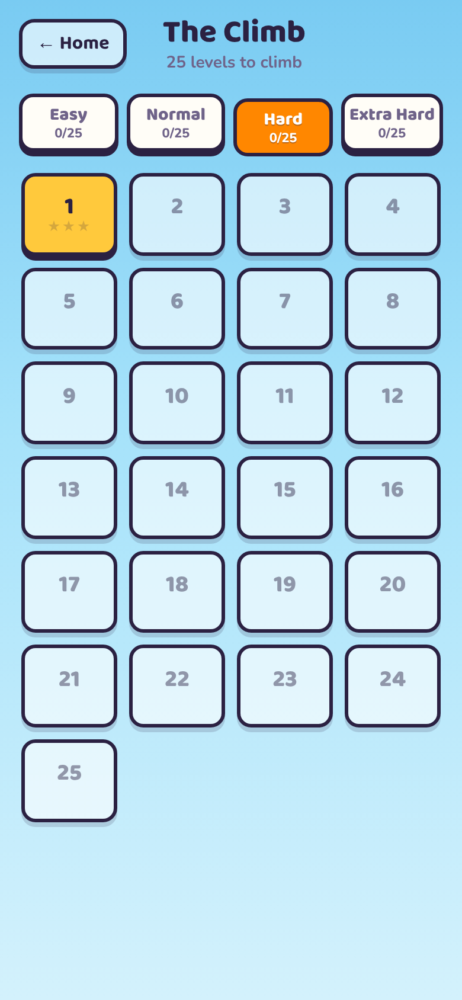
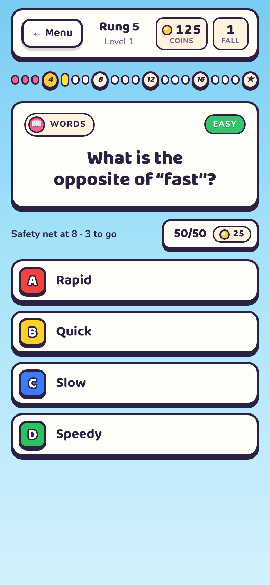
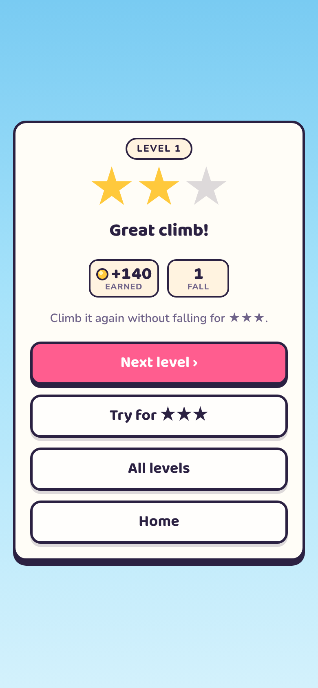
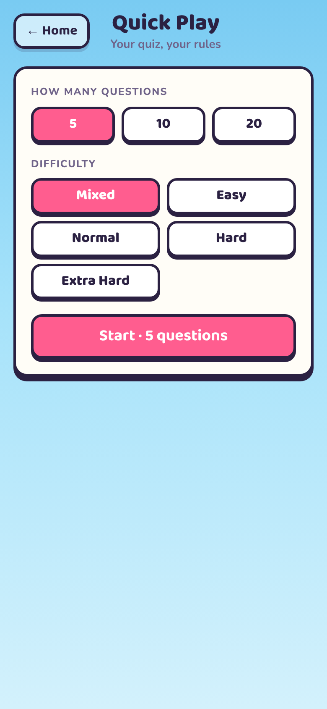
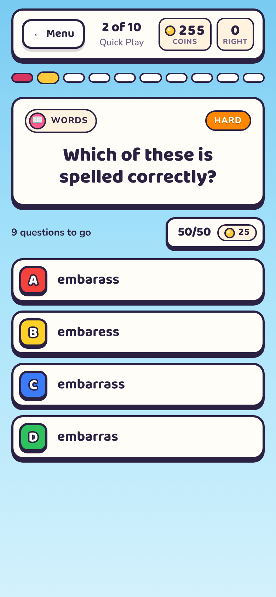
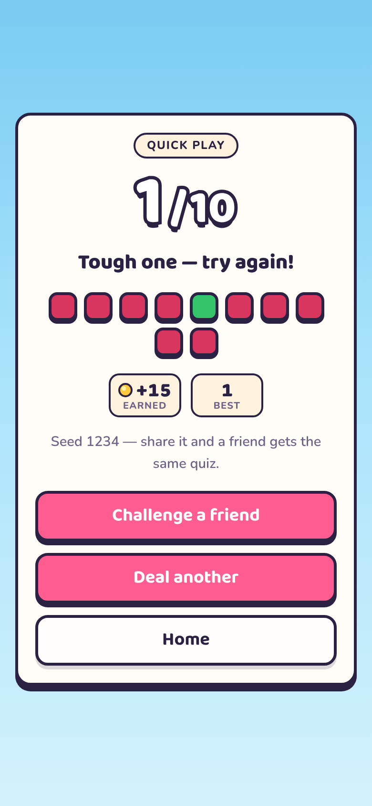
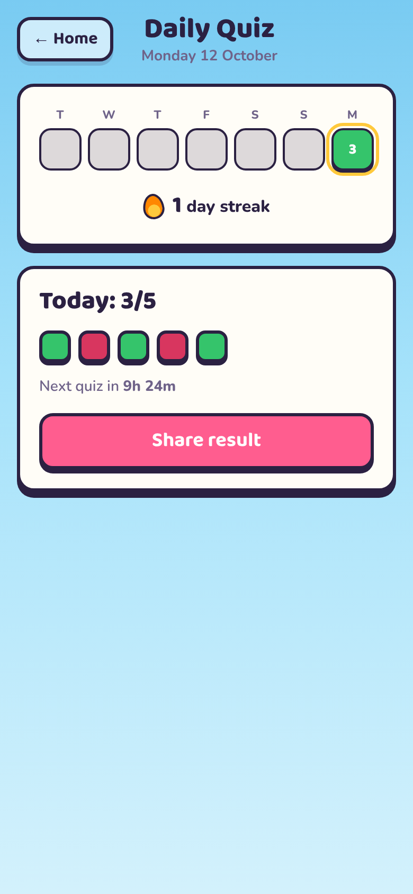
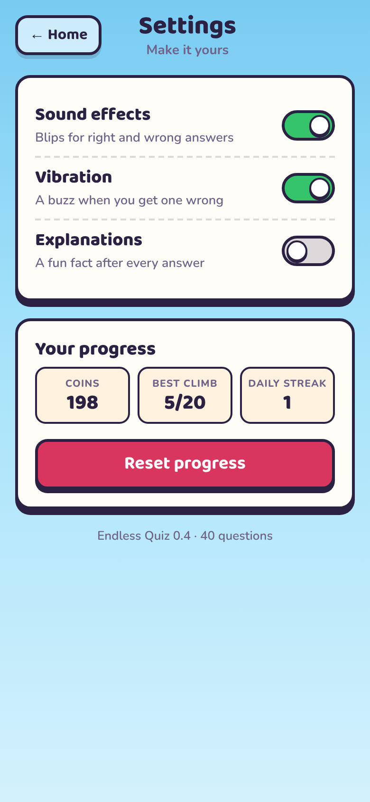
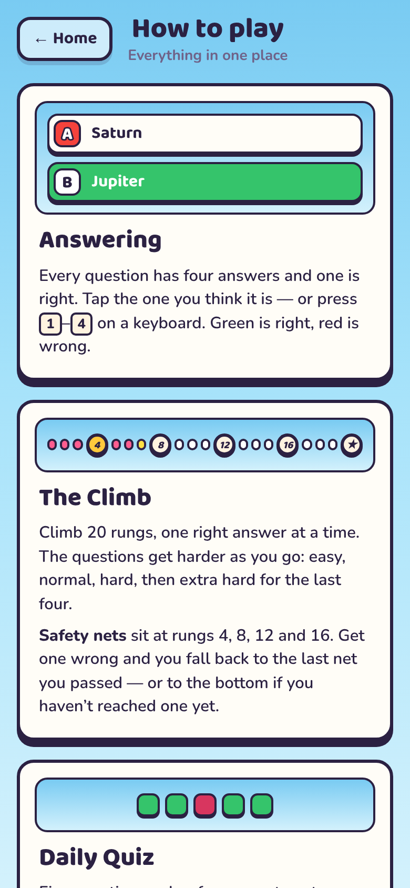

# Endless Quiz

A quiz game in the same visual style as Color Match & Merge: bright sky,
thick ink outlines, hard drop shadows.

**Status: early build.** 100 Climb levels across four difficulty tracks, the Daily Quiz, Quick Play with
categories and seeds, settings and the guide all work. The bank holds 2,551
written and fact-table questions plus endless generated maths — about 80
for most categories at every difficulty.

Open `index.html` in a browser. No build step or server is needed.

Played online at https://polite-carrot.github.io/Endless-Puzzle/ via GitHub Pages.

**Every release, bump the build number in three places together:** the `?v=`
on the links in `index.html`, `BUILD` in `js/app.js`, and `version.json`
(currently 17).
GitHub Pages lets browsers keep files for ten minutes — the page itself
included — so a phone can keep running an old build. The `?v=` stops a new
page loading an old stylesheet; `version.json` (fetched uncached on start
and whenever the game comes back on screen) lets an old page notice a newer
build exists and reload itself onto it, between questions.

<p>
  
  
  
  
</p>
<p>
  
  
  
  
</p>
<p>
  
  
</p>

## Quick Play

Laid out like the jar game's Random Puzzle: a **difficulty slider** (Mixed,
Easy, Normal, Hard, Extra Hard), **category chips** to pick what you're
quizzed on, a **− / +** count from 5 to 30, and a **seed**.

Every deal comes from a seed — typed, or picked at random when the box is
blank. The same seed with the same settings deals the same questions with
the answers in the same places, so **Challenge a friend** on the results
card shares the seed and settings along with your score.

If the chosen difficulty and categories can't fill the quiz, the screen says
how many you'll get. With Maths ticked that never happens — maths is
generated, so it tops up any gap.

## Daily Quiz

Five questions a day — easy, easy, normal, hard, extra hard — the same for
everyone. **The date is the seed** (12 Oct 2026 deals from `20261012`), so
nothing is downloaded: two people opening the same day get the same
questions with the answers in the same places. A new quiz arrives at the
player's own midnight.

- **One go.** Each answer is saved the moment it is given, so leaving
  part-way and coming back carries on rather than re-rolls. The day's
  question ids are saved when it's started, so growing the bank mid-day
  can't swap a half-played quiz for another.
- **No 50/50**, so every score is comparable.
- **Streak** counts back from today. Today not being played yet doesn't
  break it until midnight passes.
- **Share** copies a spoiler-free grid: `🟩🟩🟥🟩🟩 4/5`.

## The Climb

**Four tracks — Easy, Normal, Hard and Extra Hard** — picked from tabs along
the top of the level screen. Each track is its own run of levels with its own
stars and progress; finish a level to unlock the next one in that track.
Every track starts with **25 levels** (100 in all), and growing one is a
one-number change — see **Adding levels** below.

Each level is a ladder of **20 rungs**, easiest at the bottom. Each track
shifts its mix from level 1 to its last level:

| Track      | Level 1 (easy/normal/hard/xhard) | Level 25 |
|------------|----------------------------------|----------|
| Easy       | 18 / 2 / 0 / 0                   | 12 / 7 / 1 / 0 |
| Normal     | 6 / 12 / 2 / 0                   | 2 / 12 / 5 / 1 |
| Hard       | 0 / 6 / 12 / 2                   | 0 / 2 / 12 / 6 |
| Extra Hard | 0 / 0 / 8 / 12                   | 0 / 0 / 2 / 18 |

**Safety nets** at rungs 4, 8, 12 and 16: a wrong answer drops you to the
last net you passed. **Every rung has a backup question**, so the way back
up after a fall asks something new: a rung's first showing asks its main
question, the second its backup, and after that a stand-in of the same
difficulty from the bank.

**Stars:** no falls ★★★, one or two ★★, more ★. Replaying keeps your best.
A climb in progress is saved — track, level, rung, falls and all. Stars are
saved per track and level, as `normal-4`.

### Adding levels

1. Open `tools/build-levels.js`.
2. Raise `levels` on the track you want to grow — say Easy from 25 to 50.
3. Run `node tools/build-levels.js`.

**Levels that already exist are kept exactly as they are** — they're read
back out of `js/levels.js` and only the new ones are dealt — so nobody's
stars end up on a level that has changed under them. The builder refuses to
run if a kept level points at a question that has since left the bank.

A track's mix is set by **anchors at level numbers**, not fractions of the
track, so lengthening a track never changes the levels already in it. Levels
past the last anchor keep its mix; to make level 50 harder than level 25,
add an anchor for it, e.g. `[50, 6, 11, 3, 0]` on Easy.

`node tools/build-levels.js --rebuild-all` deals every level again — for
when you mean to reshuffle everything, before launch say.

### Why levels are baked

Levels are written out in full, as question references, rather than dealt
when the game loads. The bank will keep growing, and if levels were dealt
live, adding one question would reshuffle every level after it. Baked, a
level stays the level it was.

The builder deals written questions **least recently used first** across
all four tracks, spreads categories within each level, and never asks the
same fact twice in a level. About one slot in eight is generated maths. Its
report, now:

- 4,000 question slots (100 levels × 20 rungs × main + backup); about 1 in 8 generated
- 2,440 distinct written/table facts used, about 1.4 times each across all tracks
- within a track, a fact comes back after at least 16 levels (typically 16–18)

## Coins and lifelines

Coins are kept scarce on purpose, so that one win buys about one lifeline.
New players start with 50. What playing pays is set by `PAY` in `js/app.js`
and the `coins` on each difficulty in `js/questions.js`:

| Earned by | Coins |
|-----------|------:|
| Climbing a level the first time | Easy 25, Normal 30, Hard 35, Extra Hard 40 |
| Climbing it again for more stars | 10 |
| Climbing it again otherwise | 5 |
| Each right answer in the Daily Quiz | 5 (25 for a perfect day) |
| Each right answer in Quick Play | Easy/Normal 1, Hard/Extra Hard 2; nothing if a lifeline helped |

The Climb pays nothing per rung, only at the top. Coins buy four
**lifelines**, in a row under each question:

| Lifeline | Starts at | What it does |
|----------|----------:|--------------|
| **50/50** | 25 | Removes two wrong answers. |
| **Ask the audience** | 20 | Shows how a crowd voted, as a bar on each answer. The crowd's favourite is right every time on Easy, 90% on Normal, 75% on Hard and 60% on Extra Hard — seeded by the question, so asking twice gets the same vote. |
| **Swap** | 30 | Trades the question for another of the same difficulty that hasn't come up in this game (and, in Quick Play, from the chosen categories). |
| **Second chance** | 40 | Bought before answering. If your answer is wrong it's struck out and you pick again — no fall in the Climb, no red mark in Quick Play. |

- Each lifeline's price **doubles every time it's used in a game** (so 25,
  50, 100… for the 50/50), and each can be used once per question.
- Swap is one thing at a time: it can't be used after another lifeline on
  the same question, and the others reset for the new question.
- In Quick Play, a question got right **with help pays nothing**. A
  swapped-in question pays as normal.
- **No lifelines in the Daily Quiz**, so everyone's daily score means the same.
- Lifeline prices are part of a saved climb, so leaving and coming back
  doesn't reset them.

Keys: `H` 50/50 · `P` ask the audience (poll) · `S` swap · `R` second chance.

## The question bank

Questions come from three places, all with the same shape:
`{ id, difficulty, category, q, answers: [correct, ...3 wrong], why }`.

| Source | Where | How many |
|--------|-------|---------:|
| Written by hand | `js/questions.js` | 2,197 |
| Fact tables — capitals, elements, planets, baby animals, animal groups, animal kinds, plurals, opposites, spellings, shapes, units and time | `js/bank.js` | 354 |
| Generators — 22 kinds of maths and Roman numerals | `js/bank.js` | endless |

**Fact tables** turn one checked row into one or two questions (Italy → Rome
asks both ways round). Wrong answers are written per row wherever a careless
pick could also be right: a group of geese is a gaggle but also a flock, so
"flock" is never offered. Reverse capital questions offer countries from the
same part of the world, so you can't rule them out by continent.

**One fact, one appearance.** "What is the capital of Italy?" and "Rome is the
capital of which country?" are two questions but one fact; every question
carries a `fact` key, and the level builder, the Daily and Quick Play never
put both halves in the same game. Generated maths that lands on a question
already written by hand rolls again, and every written question has its own
wording.

**Generators** work the answer out rather than having it written, so it
can't be wrong. A generated question is named by a reference like
`g:times12:48213` — the generator and a seed — and the same reference always
makes the same question. That is what lets a Climb level store a question
as a few characters.

    node tools/check-bank.js

checks every written and table question and 2,000 seeds of every generator:
four different answers, the right one never repeated among the wrong ones,
known category and difficulty, an explanation, no duplicates. Run it after
adding questions.

| Category  | Easy | Normal | Hard | Extra Hard |
|-----------|-----:|-------:|-----:|-----------:|
| Maths     | 7 + generated | 6 + generated | 6 + generated | 4 + generated |
| Space     | 21 | 22 | 22 | 21 |
| Science   | 21 | 22 | 22 | 23 |
| Geography | 22 | 22 | 37 | 32 |
| Nature    | 21 | 21 | 22 | 22 |
| History   | 21 | 22 | 22 | 22 |
| Words     | 22 | 21 | 22 | 22 |
| General   | 21 | 22 | 21 | 22 |

Those are distinct facts. **Every category has at least 20 at every
difficulty**, so a 20-question Quick Play game on a single category never
runs short — checked by dealing all 40 combinations (8 categories × 4
difficulties + Mixed) and confirming 20 different questions each time.

## First-time tips

A new player gets a welcome on the home screen that offers to start Easy
level 1. The first time they see a question, a few tips follow, one at a
time: the answers, the ladder and its safety nets, and the lifelines. Each
tip dims everything except what it's about. Which tips have been seen is
saved in `tips`. Players whose saves are older than the tips are marked as
having seen them all. How to play has a button to show the tips again.
The first coins a player earns also come with a note on the results screen
saying what coins are for.

Right and wrong answers show a ✓ or ✕ as well as green and red, on the
answer buttons and in the results dots, so they're clear to colour-blind
players too.

## Settings

Sound effects; **haptics** — a real buzz for right and wrong answers through
Capacitor's Haptics plugin in the app (which, unlike the web's vibrate,
works on iPhone), or the browser's vibrate where there is one; explanations
after each answer; and a daily reminder (see below). Also shows your coins,
Climb levels and daily streak, with a **Reset progress** button behind a
confirmation.

### Report a question

Settings → **Report a question** lists the last 30 questions you answered,
newest first. Tap one, pick what's wrong — the marked answer is wrong,
another answer is also right, a typo, or something else — add a note if you
like, and **Send report**. The report includes the question's reference
(`history-0101`, `g:times12:48213`…) and the build, so it can be found and
fixed. It goes out through the phone's share sheet (Capacitor's Share
plugin; the browser's share, or the clipboard, elsewhere). Set
`REPORT_EMAIL` in `js/app.js` and it opens an email to that address instead.

## Daily reminders

A **Daily reminder** switch in Settings, with a time from 7am to 10pm (6pm to
start). It uses Capacitor's **LocalNotifications** plugin, so it only works
in the iPhone and Android app; in a browser the switch is greyed out and
says reminders come with the app. Turning it on asks for notification
permission; if the phone says no, the switch stays off and explains where to
allow it.

Rather than one repeating alarm, `js/reminders.js` schedules **the next
seven days as separate notifications**, and redoes the whole set whenever
the game opens, comes back on screen, finishes a Daily, or the setting
changes. That lets it:

- **skip today** once today's quiz is played (or the time has passed);
- **mention the streak** — "Keep your 6-day streak going 🔥" — on the next
  reminder when the streak is genuinely on the line, and not on a reminder
  that would arrive after it has already ended;
- **go quiet** a week after someone stops playing, rather than nagging forever.

`Reminders.plan()` is pure — no phone needed — so the rules can be checked
with plain dates.

## Building the app

Like Color Match & Merge, the game is wrapped with Capacitor:

```
npm install
npx cap add ios          # first time only
npx cap add android      # first time only
npm run sync             # copy the game into www/ and into both projects
npx cap open ios         # or: npx cap open android
```

`capacitor.config.js` runs `sync-web.js` whenever Capacitor reads it, so
`npx cap sync` on its own always ships the current files. `sync-web.js`
takes its file list from `index.html`'s own tags. App id:
`com.politecarrot.endlessquiz`.

Still to carry over from Color Match & Merge when the native projects are
added: the Android `MainActivity` tweaks (fixed text zoom, no long-press
selection on Samsung, edge-to-edge padding on Android 15+), the Polite Carrot
splash, and a white notification icon for Android's status bar.

### Screen size and text size

The question screen fits on an iPhone SE (2nd gen) without scrolling, and so
does everything else bar the long lists (levels, settings, how to play).
Screens shorter than 780pt (the SE, and bigger iPhones once the notch, home
bar or Safari's bars take their share) get a tighter layout from the
`max-height` media queries at the end of `styles.css`, with a tighter one
still below 690pt. Once a question is answered, the lifelines make way for
the verdict and the Next button, so nothing covers the answers.

**Text size:** the phone's own text-size setting (Dynamic Type on iPhone,
Font size on Android) can make the game's text smaller but never bigger than
standard. `Native.capTextSize()` reads it with Capacitor's TextZoom plugin and
sets the web view to the smaller of that and 100%, at start-up and whenever
the app comes back on screen. If the Android `MainActivity` from Color Match
& Merge is carried over, leave out its fixed `setTextZoom` so the two don't
fight.

## Keeping progress

Coins, the climb in progress, stars per level, daily results, Quick Play
bests, recent questions and settings — all in one save (`js/store.js`).

**In the app there are two copies.** The working copy is in the web view's
localStorage, which the game reads instantly at start-up. But iOS treats web
storage inside an app as a cache it may clear when the phone runs short of
space. So every save is also written to Capacitor's **Preferences** — the
phone's own UserDefaults / SharedPreferences, which the system leaves alone.
At start-up the two are compared by their save time, and if the phone's copy
is newer or the web copy has gone, it's put back before anything else runs.

**In a browser** there's only localStorage, tested with a write-and-read-back
before it's trusted; if it's refused (a private window, say) the game plays
on from memory and the home screen says progress won't be saved.

## Sound

Blips are made with oscillators, so nothing is downloaded. As in the jar
game, the audio device is suspended after a second and a half of quiet so
it can't hum, and is never opened while sound is off.

## Keyboard

`1`–`4` or `A`–`D` to answer · `H` for the 50/50 · `Enter` for the next question.

## Layout

```
index.html        every screen: home, climb levels, question, results, daily,
                  quick play, settings, how to play
styles.css        all styling (tokens shared with Color Match & Merge)
fonts.css         Baloo 2 + Nunito, inlined (copied from Color Match & Merge)
assets/           app icon: app-icon.png is the 1024px master; the others are
                  sized from it (home screen, manifest, favicon)
manifest.webmanifest  name and icons for installing to a home screen
version.json      the current build, checked on start to pick up updates
js/questions.js   categories, difficulties, the hand-written questions
js/bank.js        fact tables, generators, and the assembled bank  (no DOM)
js/levels.js      generated — the Climb's levels per track, as question references
js/store.js       saving progress, and whether it can be trusted
js/sound.js       oscillator blips
js/native.js      the phone, when there is one: haptics, share, Preferences
js/daily.js       the daily seed, streak and week   (no DOM)
js/reminders.js   daily reminder notifications (native app only)
js/app.js         screens and the shared question screen for all three modes
tools/check-bank.js    checks every question the bank can make
package.json, capacitor.config.js, sync-web.js   the native app wrapper
tools/build-levels.js  builds js/levels.js: keeps existing levels, deals new ones,
                       and reports on reuse
```

Questions are stored as `{ id, difficulty, category, q, answers, why }`, with
the correct answer first in `answers`. The app shuffles them when it shows a
question. Stick to facts that don't go out of date.
