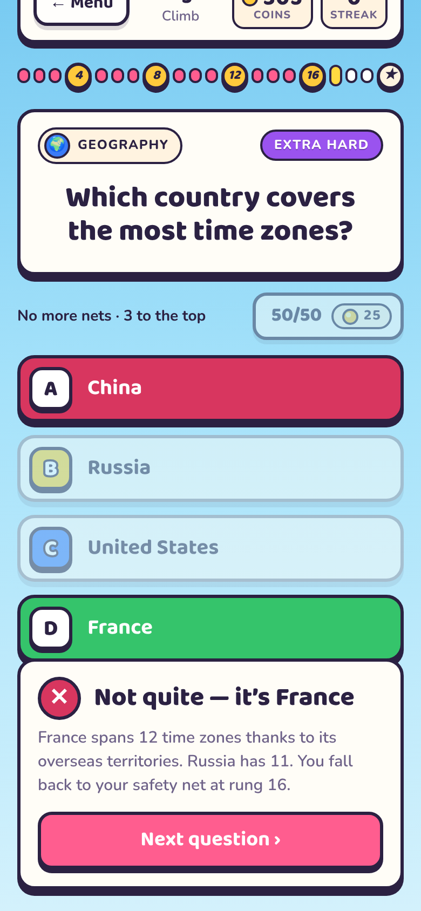

# Endless Quiz

A quiz game in the same visual style as Color Match & Merge: bright sky,
thick ink outlines, hard drop shadows.

**Status: design prototype.** One question screen, a handful of sample
questions, nothing saved between visits.

Open `index.html` in a browser. No build step or server is needed.

<p>
  
  
</p>

## The Climb

A run is a **20-rung ladder** that gets harder as you go:

| Rungs | Difficulty | Safety net |
|-------|------------|------------|
| 1–4   | Easy       | **4**      |
| 5–8   | Normal     | **8**      |
| 9–12  | Hard       | **12**     |
| 13–16 | Hard       | **16**     |
| 17–20 | Extra Hard | none (the star is the top) |

There is a safety net every four rungs. A wrong answer drops you back to the
last one you passed, or to the bottom if you haven't reached rung 4 yet.

## Coins and the 50/50

- Correct answers pay coins: Easy 5, Normal 10, Hard 15, Extra Hard 25.
- The **50/50** removes two wrong answers and costs coins. Its price
  **doubles each time it is used in a run** (25, 50, 100…). It can be used
  once per question, and a question answered with it pays half.

## Keyboard

`1`–`4` or `A`–`D` to answer · `H` for the 50/50 · `Enter` for the next question.

## Layout

```
index.html        markup
styles.css        all styling (tokens shared with Color Match & Merge)
fonts.css         Baloo 2 + Nunito, inlined (copied from Color Match & Merge)
js/questions.js   categories, difficulties, sample questions
js/app.js         the Climb: ladder, coins, 50/50, answering
```

Questions are stored as `{ id, difficulty, category, q, answers, why }`, with
the correct answer first in `answers`. The app shuffles them when it shows a
question.
